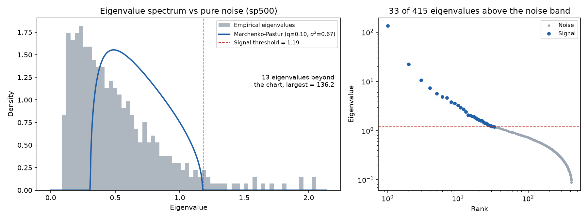
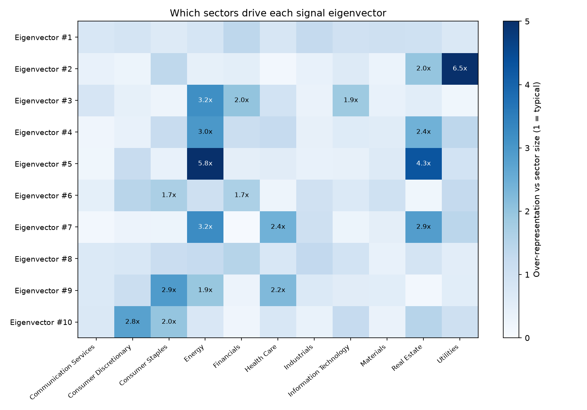
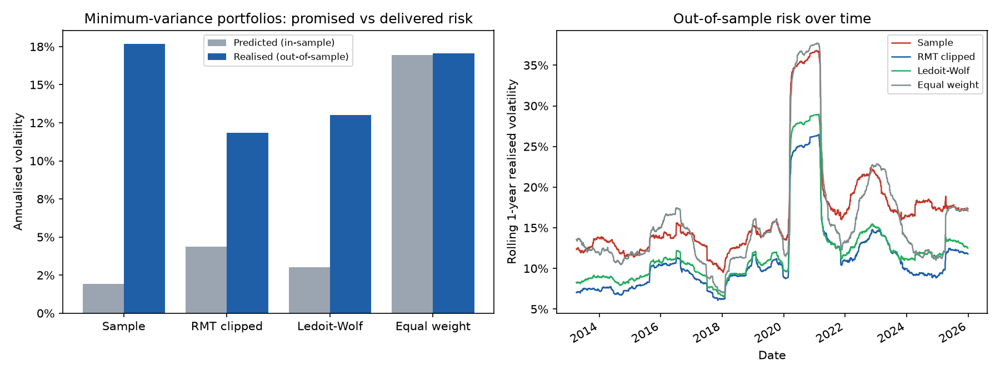

# Random Matrix Theory for Stock Correlations

How much of the S&P 500's correlation matrix is real, and how much is noise? This project borrows a tool from nuclear physics to answer that, then tests whether removing the noise builds genuinely lower-risk portfolios out-of-sample.



## The idea

With N stocks and T days of returns, a correlation matrix has N(N−1)/2 entries, about 80,000 for 400 stocks, all estimated from limited data. Many of them are mostly noise.

Random matrix theory says exactly what pure noise looks like. If the stocks were independent, the eigenvalues of their sample correlation matrix would not all equal 1. As N, T → ∞ with q = N/T fixed, they spread across a band

$$\lambda_\pm = \sigma^2 (1 \pm \sqrt{q})^2$$

following the **Marchenko-Pastur** distribution. Wigner introduced this comparison-with-randomness idea in the 1950s to study the energy levels of heavy nuclei. Applied to markets (Laloux, Cizeau, Bouchaud & Potters, 1999; Plerou et al., 1999), it shows that most eigenvalues sit inside the noise band and only a few stand out, and those few carry the economically meaningful structure.

## Method

**1. Data cleaning.** Daily log returns for current S&P 500 members with complete price history over 2010–2025. Companies listed with two share classes (GOOG/GOOGL, FOX/FOXA, NWS/NWSA) have return correlations near 0.99, which makes the covariance matrix nearly singular, so one of every pair with correlation above 0.95 is removed.

**2. Volatility standardisation.** Marchenko-Pastur assumes each return has constant variance. Real volatility clusters (March 2020 was several times more volatile than 2017), and because these regimes hit all stocks at once they create spurious common structure and widen the noise band. Each return is therefore divided by a causal EWMA forecast of its own volatility (30-day half-life, using data up to the previous day only) before correlations are computed.

**3. Noise level and signal threshold.** Signal eigenvalues absorb part of the total variance, so the noise bulk has variance σ² < 1. Following Laloux et al., σ² = 1 − λ₁/N removes the market mode's share. Because Marchenko-Pastur is an infinite-size limit, the signal threshold adds a finite-sample **Tracy-Widom** correction (Johnstone, 2001) at the ~99th percentile.

An iterative alternative (re-estimate σ² from the non-signal eigenvalues until stable) is exact for Gaussian data but **runs away on real data**: fat tails and volatility regimes make the true bulk wider than theory, each round "finds" new signal, σ² falls, and the count snowballs. On the raw S&P 500 data it flagged 188 of 416 eigenvalues as signal, against the 10–20 typically reported in the literature. The synthetic test below reproduces this failure and shows standardisation plus the market-mode estimate fixing it.

| Synthetic data with 11 true factors, volatility regimes and fat tails | Iterative σ² | Market-mode σ² |
|---|---|---|
| Raw returns | 111 | 45 |
| Volatility-standardised | 41 | **13** |

**4. Interpretation.** For each signal eigenvector, sum the squared loadings by GICS sector to see what it represents. The **inverse participation ratio**, a localisation measure from condensed-matter physics, shows how many stocks each eigenvector involves: about 3/N for a random vector, much larger for one concentrated on a sector.

**5. Cleaning.** Eigenvalue clipping keeps the signal eigenvalues and replaces all noise eigenvalues with their average. This preserves the trace, keeps the matrix invertible, and restores a unit diagonal.

**6. Out-of-sample test.** Every 21 days, estimate the correlation structure from the previous 504 days of standardised returns, combine it with each stock's current volatility forecast, and build the global minimum-variance portfolio, then hold it for the next 21 days. Minimum-variance portfolios depend only on the covariance estimate, with no return forecasts, so differences in realised risk isolate estimation quality. Four methods are compared: the raw sample matrix, RMT clipping, Ledoit-Wolf shrinkage (the standard industry benchmark), and equal weights.

## Results

Universe: 415 S&P 500 stocks with full price history, 4,022 trading days (January 2010 – December 2025). 87 tickers without full history were excluded, and GOOG was dropped as a near-duplicate of GOOGL (return correlation 0.996).

### How many real factors are there?

| Signal eigenvalues found | Iterative σ² | Market-mode σ² |
|---|---|---|
| Raw returns | 186 | 35 |
| Volatility-standardised | 161 | **33** |

The iterative noise estimate runs away on real data, flagging 40–45% of all eigenvalues as signal even after volatility standardisation. The market-mode estimate is far more stable. On real data, volatility standardisation mattered much less than on the synthetic data (35 → 33): the choice of noise estimator did most of the work.

Over the full 16-year sample, 33 of 415 eigenvalues lie above the noise band and together explain 58% of total variance. Within the rolling two-year windows used for portfolio construction, RMT keeps 16.5 on average (range 14–19), in line with the 10–20 typically reported in the literature. The longer sample finds more because the market's structure shifts over time, so a 16-year window contains factors that never coexist in any two-year one.

### What the factors are

The largest eigenvalue (136.2, about 33% of all variance) is the **market mode**: its portfolio has a correlation of 1.00 with the equal-weighted index. The algorithm was never told which sector any company belongs to, yet the next eigenvectors map onto recognisable economic groups:

- **#2: utilities** (ED, WEC, CMS, DUK, XEL), the cleanest sector factor, with utilities 6.5× over-represented.
- **#3: growth vs. value / interest rates.** Chip-design and software names (SNPS, CDNS, ADBE, MPWR) load opposite to regional banks (RF, MTB, KEY) and oil majors (XOM, COP, CVX): rising rates help bank margins and energy while hurting long-duration growth stocks.
- **#5: oil vs. retail real estate.** Oil and gas producers (COP, EOG, XOM, OXY) against shopping-centre REITs (FRT, KIM, REG, SPG), consistent with an inflation and oil-price factor.
- **#6: banks vs. housing.** BAC and JPM load opposite to homebuilders and home-improvement retailers (LEN, DHI, PHM, LOW, MAS): higher rates widen bank margins but raise mortgage costs.
- **#8: the COVID factor.** Insurance brokers and data firms (BRO, AJG, AON, VRSK) against airlines (DAL, UAL, LUV), separating businesses that held up in 2020 from those that collapsed.
- **#9: life-science tools vs. consumer staples.** Lab-equipment makers (TMO, WAT, A, CRL) against COST, PEP and KO, a growth-vs-defensive split.

Eigenvector signs are arbitrary, but relative signs are not: stocks on opposite sides of a factor tend to move against each other when that factor is active. These labels are interpretations of the loadings, not something the method asserts; confirming them would mean regressing each factor portfolio on observable drivers such as Treasury yields or oil prices.



The heatmap shows each sector's *lift*: its share of the eigenvector's weight divided by its share of stocks. Raw shares are misleading because Financials is the largest sector and tops many lists by size alone.

### Do cleaner correlations give lower-risk portfolios?

Rolling 504-day estimation window (q = N/T ≈ 0.82), rebalanced every 21 days, all out-of-sample:

| Method | Predicted vol | Realised vol | Realised / predicted | Gross leverage |
|---|---|---|---|---|
| Sample | 1.9% | 17.6% | 9.2× | 13.3 |
| **RMT clipped** | 4.4% | **11.8%** | 2.7× | 3.9 |
| Ledoit-Wolf | 3.0% | 13.0% | 4.3× | 6.8 |
| Equal weight | 16.9% | 17.1% | 1.0× | 1.0 |



**Key findings.** RMT clipping delivered the lowest realised risk, about 31% below equal weighting and 9% below Ledoit-Wolf shrinkage, while needing far less leverage. The raw sample matrix is worse than useless for optimisation: it promised 1.9% volatility, delivered 17.6%, and did no better than simply holding everything equally. Every optimised portfolio still under-predicted its own risk, RMT included (2.7×), a reminder that a cleaner correlation matrix does not fix fat tails or correlations that change over time.

### A theoretical check

For minimum-variance portfolios built on the sample covariance matrix, RMT predicts realised volatility exceeds in-sample volatility by a factor of about **1/(1 − q)**: the optimiser overfits noise, finding "safe" directions that are not really safe.

| Data | q | Predicted by theory | Observed |
|---|---|---|---|
| Synthetic, Gaussian, constant volatility | 0.79 | 4.8× | 4.9× |
| Synthetic, volatility regimes + fat tails | 0.79 | 4.8× | 6.9× |
| S&P 500 | 0.82 | 5.7× | 9.2× |

Theory is spot on when its assumptions hold, and the gap grows as the data become more realistic. The extra error on real data is the part due to fat tails and non-stationarity rather than sampling noise.

### The bugs that became findings

Two problems in the first real-data run are worth recording. With both GOOG and GOOGL in the universe, the sample-matrix portfolio ran 475× gross leverage and 180% realised volatility, because the optimiser treated two share classes of the same company as a riskless long-short pair. Removing one cut leverage to 13×. Separately, the iterative noise estimate flagged 188 of 416 eigenvalues as signal; diagnosing this led to the synthetic "realistic" test case and the market-mode estimator now used by default.

## Validation

`pytest -q` runs 23 tests:

- the Marchenko-Pastur density integrates to 1;
- pure noise produces **zero** signal eigenvalues and stays inside the predicted band;
- a synthetic factor model (market plus 5 sectors) yields exactly the right number of signal eigenvalues;
- on realistic synthetic data (volatility regimes, fat tails) the naive approach overcounts factors badly, while standardisation plus the market-mode estimate lands close to the truth;
- duplicate share classes are detected and removed, and the volatility forecast is causal;
- cleaned matrices are valid correlation matrices (symmetric, unit diagonal, positive definite);
- minimum-variance weights are actually optimal;
- the backtest is causal: scrambling all returns after a cutoff leaves earlier results unchanged.

`python run.py --synthetic` runs the whole pipeline on the factor model, where the right answers are known.

## Limitations

- **Survivorship bias.** The universe is today's S&P 500 constituents with full history, so firms that left the index or failed are excluded. Point-in-time constituents (e.g. from CRSP) would fix this.
- **Stationarity.** RMT assumes correlations are constant within each window, but they rise sharply in crises. Shorter windows track this better but raise q, making estimates noisier: a direct trade-off worth exploring with `--window`.
- **Clipping is the simplest cleaning method.** Rotationally invariant estimators (Bun, Bouchaud & Potters, 2017) are optimal under RMT assumptions and a natural extension.
- **Fat tails.** Volatility standardisation removes volatility clustering but not all of the fat-tailedness of returns, which still widens the noise band slightly; on the synthetic data the method finds 12–15 factors where 11 are real. Robust correlation estimators (e.g. Kendall's tau, or Student-t based estimators) would reduce this further.
- **Duplicate detection uses the full sample.** Choosing which share class to drop looks at all 16 years of data. This is a data-cleaning step rather than a trading decision, but a strictly point-in-time version would decide using past data only.

## Usage

```bash
pip install -r requirements.txt
python run.py                      # S&P 500, 2010-2025 (first run downloads ~500 tickers, a few minutes)
python run.py --window 252         # 1-year estimation window (noisier, q closer to 1)
python run.py --raw --noise iterative   # the original naive approach, for comparison
python run.py --synthetic          # offline check: 11 known factors, volatility regimes, fat tails
pytest -q
```

## Structure

```
rmt/
  data.py        S&P 500 constituents (Wikipedia), batched Yahoo download + cache, duplicate
                 share-class removal, synthetic factor model
  volatility.py  causal EWMA volatility forecasts and standardisation
  theory.py      Marchenko-Pastur law, Tracy-Widom threshold, noise estimation, clipping, IPR
  portfolio.py   minimum-variance portfolios and the rolling out-of-sample backtest
  analysis.py    spectrum analysis and charts
tests/           theory, cleaning, robustness, optimality and causality tests
pytest.ini       lets `pytest` find the rmt package
run.py           runs the study and saves results/ (CSV, JSON, charts)
```

## References

- Laloux, Cizeau, Bouchaud & Potters (1999). Noise dressing of financial correlation matrices. *Physical Review Letters* 83.
- Plerou, Gopikrishnan, Rosenow, Amaral & Stanley (1999). Universal and nonuniversal properties of cross correlations in financial time series. *Physical Review Letters* 83.
- Johnstone (2001). On the distribution of the largest eigenvalue in principal components analysis. *Annals of Statistics* 29.
- Bun, Bouchaud & Potters (2017). Cleaning large correlation matrices: tools from random matrix theory. *Physics Reports* 666.
